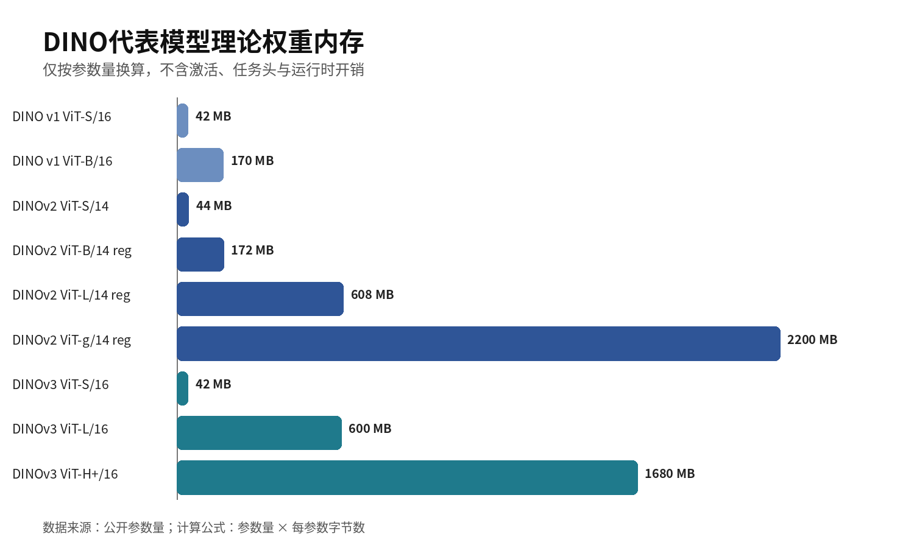
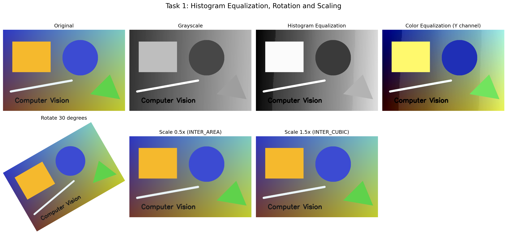
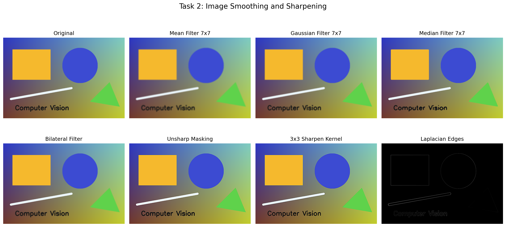
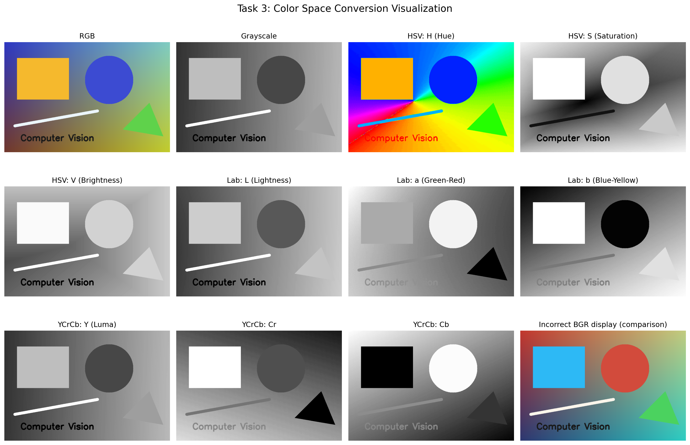

# Computer Vision Course Project

本仓库整理了计算机视觉课程大作业中可复现的代码与实验结果，主要包括两部分：

1. **DINO 系列模型部署分析**：根据公开模型参数，估算权重内存、输入分辨率对注意力计算规模的影响，并在显存、任务类型和许可条件下筛选候选模型；
2. **Python 图像处理课后作业**：实现直方图均衡化、旋转、缩放、图像平滑、锐化，以及不同颜色空间转换与可视化。

> 仓库只包含代码、必要的示例输入和可复核结果，不包含课程报告、姓名、学号等个人材料，也不包含模型权重或课程数据集。

## 目录结构

```text
.
├── dino_deployment/
│   ├── cases/       # EASE 中 DINOv2 特征链路的复现说明
│   ├── data/        # 公开模型参数登记表
│   ├── results/     # 脚本生成的 CSV 与可视化结果
│   └── src/         # DINO 部署与资源分析代码
├── image_processing/
│   ├── input/       # 固定示例图像
│   ├── results/     # 三项课后作业的结果图
│   └── src/         # 图像处理代码
└── requirements.txt
```

## 安装依赖

建议使用 Python 3.10 或更高版本：

```bash
python -m venv .venv
source .venv/bin/activate
python -m pip install -r requirements.txt
```

Windows PowerShell 激活虚拟环境可使用：

```powershell
.venv\Scripts\Activate.ps1
```

## 运行 DINO 部署分析

```bash
python dino_deployment/src/dino_deployment_demo.py
```

按 8 GB 显存、多任务特征复用和 Apache-2.0 许可条件筛选模型：

```bash
python dino_deployment/src/dino_deployment_demo.py \
  --gpu-memory-gb 8 --multitask --apache-only
```

脚本会更新 `dino_deployment/results/` 中的表格和图像。这里的显存与复杂度数据属于公式估算，不应写成真实 GPU 测试结果。

## 运行图像处理作业

```bash
python image_processing/src/run_all.py
```

该命令会生成固定示例图像，并依次执行：

- 灰度和彩色亮度通道直方图均衡化、30° 旋转、0.5 倍和 1.5 倍缩放；
- 均值、高斯、中值、双边平滑，以及反锐化掩模、卷积核锐化与 Laplacian 边缘响应；
- RGB、灰度、HSV、Lab 和 YCrCb 颜色空间及其通道可视化。

## DINOv2 / EASE 使用案例

`dino_deployment/cases/EASE_DINOv2_case.md` 记录了 EASE 如何使用 DINOv2-ViT-L/14 提取全局和局部特征、构建环境原型并进行相似度检索。

EASE 是第三方研究项目，原始代码请见：<https://github.com/xiaohainku/EASE>。本仓库不重新发布其完整源码，也不把第三方代码作为本课程项目原创内容。

## 结果预览

### DINO 模型资源估算



### 图像处理任务







## 说明

- DINO 部分不自动下载模型权重，能够在普通 Python 环境中复核资源估算与模型筛选逻辑；
- EASE 的完整复现还需要 DINOv2、FAISS、生成图像、公开测试集及相关分割模型，具体依赖以原项目为准；
- 仓库中的结果文件可由相应脚本重新生成。
